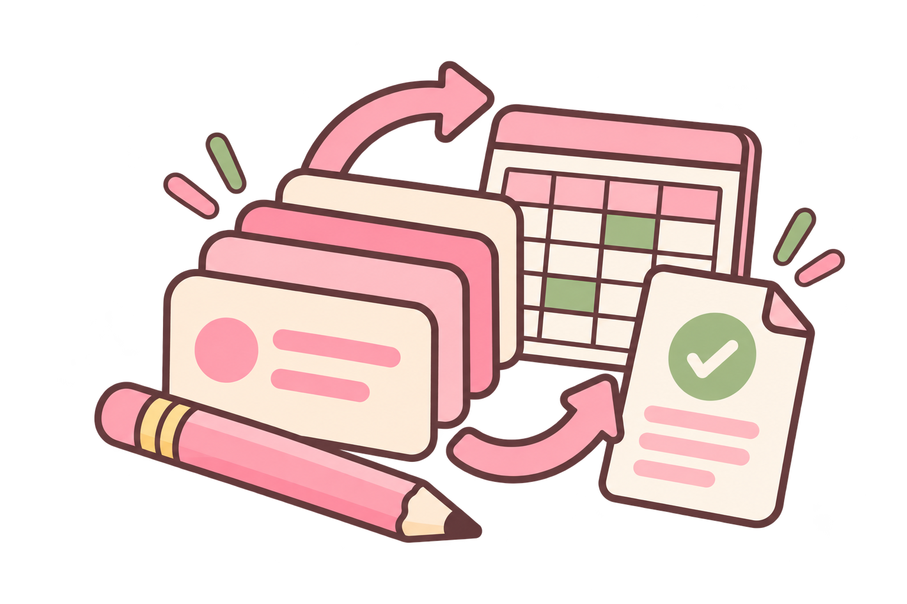
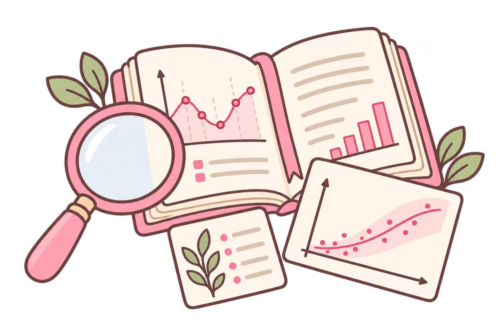

# Kishia Nikole Gaytano

### Data and Automation | Machine Learning | AI Engineering

I work in the space between a dataset and a decision.

[LinkedIn](https://www.linkedin.com/in/kishia-gaytano) ·
[Email](mailto:kishia.nikole@gmail.com) ·
[GitHub](https://github.com/kishiagaytano)

---

## About me

I'm a 4th-year BS Computer Science student at
[FEU Institute of Technology](https://www.feutech.edu.ph/), specializing in
Data Science.

My work sits where modeling meets a real decision: automating repetitive
operations, building interpretable machine-learning systems, and designing
AI workflows that make complex information easier to use.

I care about more than whether a model runs. I care whether its assumptions are
visible, its limits are honest, and its output helps someone do something better.

## What I work on

<table>
<tr>
<td width="33%" valign="top" align="center">

### Data + Automation

Turning repetitive, error-prone processes into reliable workflows.

Power BI · Looker · Tableau · Microsoft Apps · Google Workspace · SQL · OCR · JavaScript

</td>
<td width="33%" valign="top" align="center">

### ML + Research

Building models that explain patterns and support real-world decisions.

Python · SAS · ML/DL libraries · SHAP

</td>
<td width="33%" valign="top" align="center">

### AI Systems

Designing agent workflows with retrieval, guardrails, tracing, and clear limits.

AWS · Bedrock · RAG · AgentCore · DynamoDB · CloudWatch

</td>
</tr>
</table>

## Selected work

<table>
<tr>
<th>Project</th>
<th>What it does</th>
</tr>
<tr>
<td><a href="https://github.com/kishiagaytano/avilight"><b>AviLight</b></a></td>
<td>Forecasts bird species richness under artificial light at night across Metro Manila using a meta-stacked XGBoost and ConvLSTM ensemble, built with the DENR-BMB Wildlife Resources Division.</td>
</tr>
<tr>
<td><a href="https://github.com/kishiagaytano/archeon"><b>Archeon</b></a></td>
<td>An AI-powered architectural memory tool that helps engineering teams understand why code evolved, not just what changed. I led the interface, documentation, and demo experience.</td>
</tr>
<tr>
<td><a href="https://github.com/kishiagaytano/caserelay-agentcore"><b>CaseRelay</b></a></td>
<td>A multi-agent customer support system built with Amazon Bedrock AgentCore. Specialist agents handle inventory, refunds, policy retrieval, and response drafting with guardrails and end-to-end tracing.</td>
</tr>
<tr>
<td><a href="https://github.com/kishiagaytano/risk-weave"><b>Risk Weave</b></a></td>
<td>A credit-risk modeling and approval decisioning system for the SAS Hackathon 2026 Student Track. It turns probability estimates into explicit, explainable loan decisions.</td>
</tr>
<tr>
<td><a href="https://github.com/kishiagaytano/wilt"><b>Wilt</b></a></td>
<td>Ranks pages whose click-through rate underperforms what their search position predicts. Built over a 79M-row, 17-month panel using DuckDB, grouped validation, and a sealed final-month test window.</td>
</tr>
<tr>
<td><a href="https://github.com/kishiagaytano/replay"><b>rePlay</b></a></td>
<td>A gamified platform that transforms verified Philippine information crises into interactive, evidence-based simulations for media and information literacy.</td>
</tr>
</table>

## How I build

`messy evidence` → `careful preparation` → `model, workflow, or agent` → `interpretable result` → `better human decision`

I try to keep the reasoning visible:

- document assumptions
- validate against realistic failure cases
- measure what matters
- surface uncertainty instead of hiding it
- design for the person who has to use the result

## Currently exploring

- privacy-aware AI systems
- interpretable and responsible machine learning
- agent workflows with guardrails and observability
- environmental and biodiversity modeling
- practical data products for Philippine communities

## Beyond code

I enjoy the parts of technical work that involve people: leading applied
research teams, presenting technical work to mixed audiences, sharing knowledge
through hands-on workshops, and translating research into useful
recommendations.

I believe good technical work should be rigorous enough to defend and human
enough to use.

## Tools I reach for

Open to research collaborations and data science opportunities.

